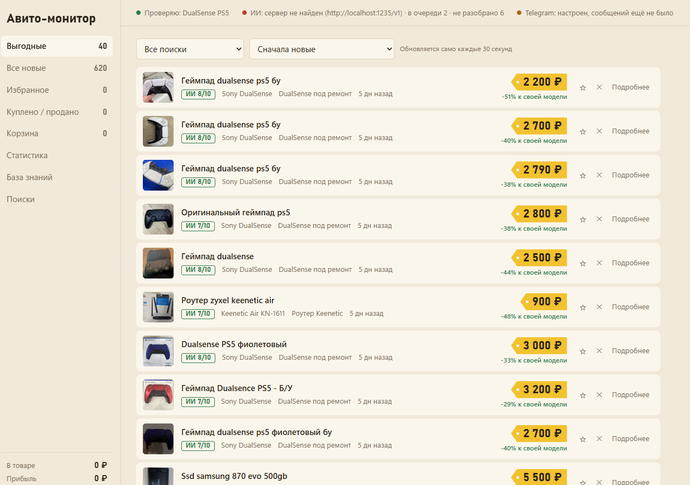

# AI Marketplace Scanner — поиск выгодных объявлений с помощью локальной LLM

> **Статус: в разработке.** Это личный учебный проект, он не закончен. Ниже — честный список того, что работает и что проверено только на тестовых данных.

## Что это и зачем

Личный проект для перепродажи: монитор следит за объявлениями на Авито, локальная мультимодальная модель (например, Qwen) разбирает каждое объявление, а программа сравнивает цену с рыночной по **той же модели товара** и сообщает, если вещь продаётся заметно дешевле рынка.

Идея: не считать «выгодным» всё, что просто дёшево (аксессуары, запчасти, сломанные вещи), а сравнивать честно — модель с моделью, с учётом состояния и ваших расходов на комиссию и дорогу.

Всё, что касается нейросети, работает локально: объявления не уходят во внешние сервисы.

## Архитектура

```
монитор ──► разбор нейросетью ──► база знаний цен ──► автопилот-агент ──► дашборд Flask ──► Telegram
(Playwright)  (текст + фото → JSON)   (медиана по модели,    (сам включает/выключает   (лента, избранное,   (уведомления)
                                       «брать до»)             свои поиски)             учёт сделок)
```

1. **Монитор** обходит ссылки поиска в браузере (Playwright), сохраняет заголовок, цену, описание, адрес и превью. Умеет замечать снижение цены и «снятые» объявления.
2. **Разбор нейросетью**: объявления отправляются локальной модели через OpenAI-совместимый API, ответ — JSON: нормализованное название товара, точная ли модель, это ли нужный товар (не аксессуар/копия), состояние, оценка 0–10, комментарий. Сначала пачкой по тексту; перепроверка выгодных по фото включается параметром `LLM_USE_PHOTOS = True` в начале файла (по умолчанию выключена).
3. **База знаний цен**: по каждой точной модели считается медиана, тренд, спрос и цена «брать до» (с учётом комиссии, расходов и целевой прибыли — настраиваются в начале файла).
4. **Автопилот**: модель сама предлагает новые поиски, автопилот принимает их, а неудачные поиски (в выдаче мало нужного товара) выключает. Свои поиски пользователя он не трогает.
5. **Дашборд (Flask)**: лента находок, избранное, учёт покупок и продаж, поиски, база знаний, журнал автопилота.
6. **Telegram**: уведомления о находках, кнопки под сообщением («в избранное», «в корзину», «купил»).

## Стек

Python · Playwright · Flask · SQLite · локальная LLM через OpenAI-совместимый API (Ollama / LM Studio / llama-server).

Весь код — один файл `avito_dashboard.py` (серверная часть и встроенная страница дашборда), данные для демо — `demo_data.json`.

## Запуск в демо-режиме за 5 минут

Демо-режим включён по умолчанию. Он **не ходит на Авито**, не использует Telegram и не требует нейросети: берёт 15 выдуманных объявлений (мониторы, роутеры, геймпады) из `demo_data.json`, а ответы «модели» отдаёт заранее записанные. Остальной конвейер (разбор ответа, база знаний, сигналы «выгодно», автопилот, дашборд) работает как обычно.

```bash
git clone https://github.com/L1pk1t/ai-marketplace-scanner.git
cd ai-marketplace-scanner
python -m venv venv
venv\Scripts\activate          # Linux/macOS: source venv/bin/activate
pip install -r requirements.txt
python avito_dashboard.py
```

Откройте <http://127.0.0.1:8000>, введите любое имя и пароль `demo`.

Что произойдёт: сразу появятся 12 объявлений, нейросеть-заглушка разберёт их, в базе знаний появятся цены по моделям, автопилот добавит два предложенных поиска. Ещё три «выгодные» находки (монитор, роутер, геймпад) появятся в ленте примерно через 40, 90 и 140 секунд.

Чтобы начать демо заново, остановите программу и удалите папку `data/`.

Хотите прогнать демо через настоящую модель — поднимите Ollama или LM Studio, скопируйте `.env.example` в `.env` и поставьте `DEMO_REAL_LLM=1` и свой `LLM_URL`.

## Настройки

Все секреты и личные пути задаются переменными окружения или файлом `.env` (образец с комментариями — `.env.example`). Файл `.env`, базы, кэш фото и профиль браузера с сессией Авито находятся в `.gitignore` и не попадают в репозиторий. Остальные параметры (паузы, бюджет, экономика сделки, пороги автопилота) лежат в начале `avito_dashboard.py`.

## Статус разработки

**Работает и проверено на демо-данных** (запуск `DEMO=1`, заглушка вместо модели):
- запуск, вход в дашборд по паролю, вкладки и API дашборда отвечают без ошибок;
- разбор ответа модели в JSON и запись вердиктов в базу;
- база знаний: медиана по модели, цена «брать до», исключение неисправных и «не тех» товаров;
- сигнал «выгодно» по сравнению с рынком той же модели (3 демо-находки);
- автопилот принимает предложенные нейросетью поиски и пишет журнал.

**Написано, но не проверено в этой публичной версии** (раньше запускалось у автора на реальных данных, при подготовке к публикации заново не гонялось):
- сбор с Авито через Playwright, вход в аккаунт, обработка капчи и блокировок;
- разбор настоящей локальной моделью, перепроверка по фото;
- Telegram-уведомления, кнопки под сообщениями, чтение публичных каналов;
- «досье товара» (поиск в интернете через MCP в LM Studio), экспорт заметок в Obsidian;
- отслеживание снижения цены, просмотров и «снятых» объявлений.

**Не доделано / известные ограничения:**
- точность разбора зависит от модели и промпта — промпты не подстраивались и не мерились на размеченной выборке;
- «выгодно» считается по медиане цен объявлений (цен предложения), а не по реальным ценам сделок;
- автоматических тестов нет; весь код в одном файле;
- отключение неудачных автопилотом поисков в демо не показывается (нужно 20+ разобранных объявлений по поиску);
- сайт защищён одним общим паролем, это не продакшн-уровень безопасности; сервер — встроенный в Flask;
- при смене вёрстки Авито селекторы в монитор придётся править руками.

## Roadmap

- [ ] Кнопки в Telegram: расширить набор действий и быстрый ответ продавцу
- [ ] Подстройка промпта под результаты (разметка выборки, измерение точности)
- [ ] Сбор полных описаний объявлений и параметров товара
- [ ] Учёт фактических цен продажи вместо цен предложения
- [ ] Автотесты и разбиение кода на модули
- [ ] Скриншоты и описание работы в `docs/`

## Скриншоты



## Дисклеймер

Это учебный проект. Автоматический сбор данных с сайтов может нарушать их правила использования и законодательство; за использование реального режима (`DEMO=0`) ответственность несёт пользователь. Проект не аффилирован с Авито и не одобрен ими. Не собирайте и не публикуйте чужие персональные данные, соблюдайте паузы между запросами. В репозитории нет реальных объявлений, учётных данных и личных данных.
